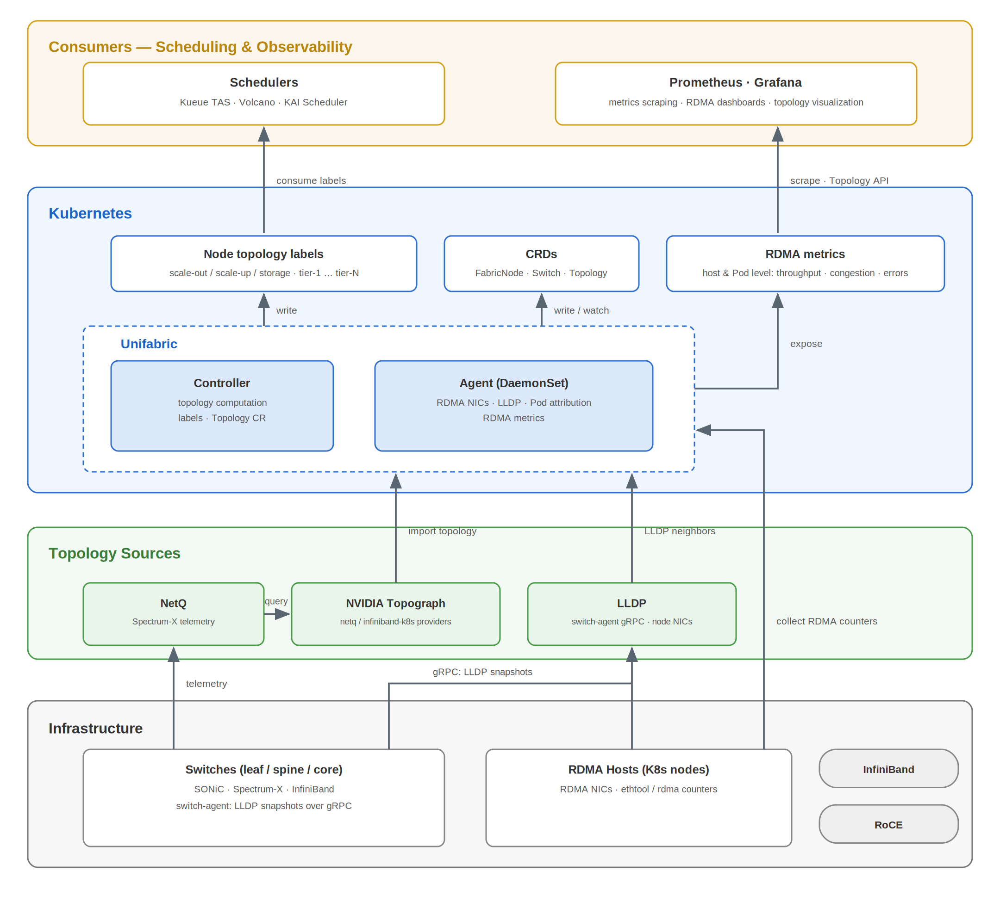

# Unifabric

> RDMA network topology discovery and observability for Kubernetes AI clusters.

## Introduction

AI clusters move training data between GPUs over RDMA networks. RDMA (direct memory
access between servers, without CPU copies) runs on RoCE or InfiniBand fabrics.
Kubernetes has no view of this network. The scheduler cannot tell whether two nodes
share a leaf switch. Operators cannot attribute RDMA traffic or errors to the
workloads that cause them. The result is avoidable cross-spine traffic, lower GPU
utilization, and slow network troubleshooting.

Unifabric closes this gap. It discovers the RDMA network topology of the cluster
automatically. It publishes the result as Kubernetes resources and as labels on each
Node, which schedulers consume. It also exposes RDMA metrics attributed to Pods and
workloads, with prebuilt Grafana dashboards.

Unifabric fits any Kubernetes cluster with an RDMA fabric. It supports general SONiC
RoCE networks, NVIDIA Spectrum-X, and InfiniBand.

## Core Features

- Automatic discovery of scale-out, scale-up, and storage network topologies
- Support for general SONiC RoCE, NVIDIA Spectrum-X, and InfiniBand fabrics
- Tiered Node labels that Kueue TAS, Volcano, and KAI Scheduler consume for topology-aware placement
- RDMA throughput, congestion, and error metrics attributed to Pods, namespaces, and workloads
- Interactive visualization of the discovered fabric in Grafana
- Queryable network state through the `FabricNode`, `Switch`, and `Topology` resources

## Architecture

Unifabric sits between the physical RDMA network and the scheduling and observability
stack. An Agent runs on every node and collects RDMA NICs, LLDP neighbors, and RDMA
Pod attribution into `FabricNode` resources. The Controller computes the topology from
`FabricNode` and `Switch` data, or imports it from NVIDIA Topograph. It then writes
Node topology labels and maintains the read-only `Topology` resource. An optional
Switch Agent runs on SONiC switches and reports switch-side neighbors for
switch-to-switch discovery. For details, see the
[architecture overview](./concepts-architecture.md).

## Quick Start

1. Complete the [basic installation](../../getting-started.md).
2. Follow the guide for your physical network:
   - [General SONiC RoCE](../../getting-started-sonic-roce.md)
   - [NVIDIA Spectrum-X](../../getting-started-spectrum-x.md)
   - [InfiniBand](../../getting-started-infiniband.md)

## Documentation

| Category | Link |
| --- | --- |
| Documentation index | [docs/README.md](../../README.md) |
| Architecture and concepts | [Architecture overview](./concepts-architecture.md) |
| Getting started | [Basic installation](../../getting-started.md) |
| Feature usage | [Topology visualization](../../usage/topology-visualization.md), [RDMA metrics](../../usage/rdma-metrics.md), [Workload TAS](../../usage/workload-tas.md) |
| API reference | [FabricNode, Switch, and Topology](../../reference/README.md) |
| Helm values | [Chart reference](../../../chart/README.md) |
| Design documents | [docs/design/](../../design/) |

## Community and Contributing

Contributions are welcome:

- Report bugs or propose features through [GitHub issues](https://github.com/unifabric-io/unifabric/issues).
- Set up a development environment with the [NVAIR development guide](../../development/dev-with-nvair.md).
- Sign off your commits with `git commit -s` to certify the [Developer Certificate of Origin](https://developercertificate.org/).

## License

Apache License 2.0. See [LICENSE](../../../LICENSE).
