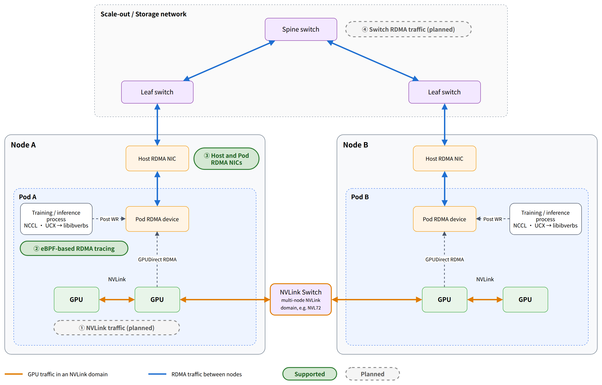
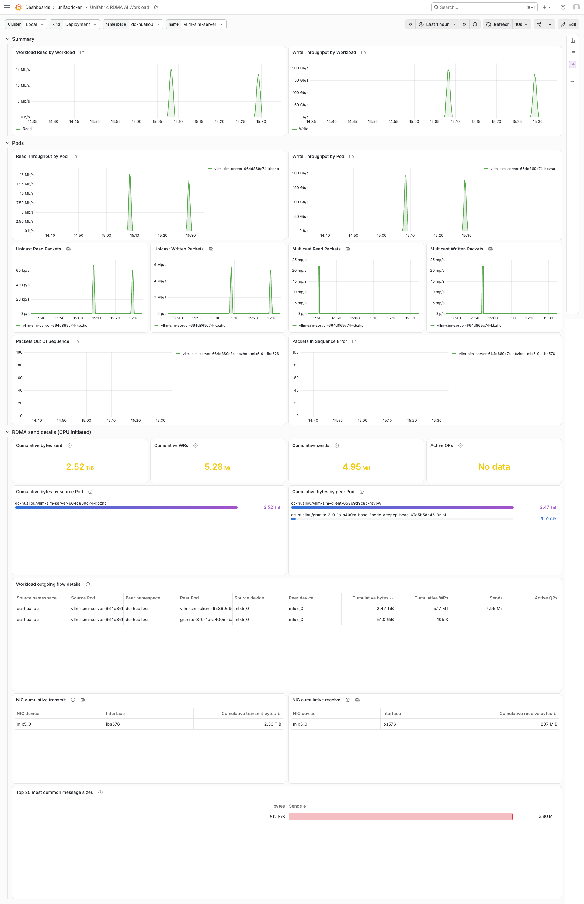

# High-Speed Network Traffic Observability

中文版: [README.zh.md](./README.zh.md)

## Introduction

Unifabric high-speed network traffic observability collects the communication traffic of AI applications on the high-speed networks.
It associates the traffic with Pods, namespaces, and top-level workloads.
It covers NVLink traffic between GPUs in an NVLink domain, and traffic between nodes that goes from Pods through RDMA NICs and switches.
It gives the results as Prometheus metrics, `RDMAEndpoint` resources, and Grafana dashboards.

In this document you learn:

- Which locations on the communication path traffic observability covers, and whether Unifabric supports each location now.
- How the data of each location is associated with one Pod identity.
- Where to find the configuration and verification steps of each observation method.

## Background

AI training jobs and inference jobs are, at their core, communication between GPUs.
The Pods of one job run on many nodes.
GPUs in the same NVLink domain communicate through NVLink.
GPU traffic outside the NVLink domain uses RDMA and goes through the RDMA NIC of the Pod, the RDMA NIC of the host, and switches.
The traffic that Pods use to read and write models, datasets, and KV cache also goes through RDMA NICs and switches.
Congestion or errors at any location on this path can make the full job slow.

But this path is almost a black box to the cloud-native stack:

- Usual network observability tools do not work.

  RDMA bypasses the kernel network stack. The NIC sends and receives the data directly.
  Packet capture, connection tracking, and tools that use the kernel network stack see only TCP/IP traffic. They do not see RDMA traffic.
  Only device-level total counters stay on the NIC.

- The data at each location is not connected, and it has no workload identity.

  Switch counters are in the network management platform. Host NIC counters are in the sysfs of the host.
  The SR-IOV VF of a Pod is in the network namespace of the Pod, so monitoring tools on the host do not see it.
  Pods in host mode share the host NIC, so the counters cannot tell which Pod the traffic belongs to.
  This data records only devices, for example `mlx5_0` or a switch port. It does not record Pods.
  Kubernetes knows Pods, but it cannot see this hardware.
  This is the "last mile" between the cloud-native stack and the high-speed network.

- The communication relations are a black box.

  You can know how much traffic a Pod sends, but you do not know where the traffic goes.
  When a job becomes slow, operators cannot answer "whose traffic uses the bandwidth, and which jobs does it affect".
  During performance tuning, they cannot make sure that the peers, the timing, and the message sizes are as expected.

High-speed network traffic observability solves these problems.
It collects traffic at each location on the communication path, and associates the data of each location with one Pod identity.
Operators can start from a workload and find which peers its Pods talk to, which NICs the traffic goes through, and if these NICs have congestion or errors.
Then they can find out if the network makes a job slow, and whose traffic affects whom.

## Prerequisites

- You deployed Unifabric according to the [basic installation](../../getting-started.md).
- Prometheus Operator is installed in the cluster.
- Only for Grafana dashboards: Grafana Operator (v5 or later) or the Grafana sidecar is installed in the cluster.

For the other requirements of each observation method, see the related document.

## Traffic observability scope

The diagram shows the communication path of AI applications, and the observation locations on the path.
GPUs in the same NVLink domain communicate through NVLink. An NVLink domain can span many nodes.
Traffic through the RDMA NICs starts when the application process in a Pod submits an RDMA request. It goes through the RDMA NIC of the Pod, the RDMA NIC of the host, and switches, to the Pod on the peer node.



| Observation location | Observed data | Support status | Document |
| --- | --- | --- | --- |
| ① NVLink | NVLink traffic between GPUs in an NVLink domain | Planned | None |
| ② RDMA submit path | RDMA flows between Pods: who talks to whom, how much traffic, and how large each send is | Supported | [eBPF-based RDMA tracing](./rdma-flow.md), [RDMA send event storage](./rdma-flow-events.md) |
| ③ Host and Pod RDMA NICs | Throughput, congestion, errors, and retransmissions of the NICs | Supported | [RDMA metrics](./rdma-metrics.md) |
| ④ Switches | RDMA traffic on switch ports | Planned | None |

The traffic of the Scale-out network and the Storage network goes through ② to ④.
The traffic of the Scale-up network goes through ①.

### NVLink traffic observability

| Item | Description |
| --- | --- |
| Observed object | Traffic between GPUs in an NVLink domain through NVLink and NVLink Switch |
| Support status | Planned |

The size of an NVLink domain depends on the server:

- In an 8-GPU server, for example DGX B200, the NVLink domain is one node. NVLink traffic stays in the node.
- In a multi-node NVLink system, for example GB200 NVL72 and GB300 NVL72, NVLink Switches connect the 18 compute nodes of one rack into one NVLink domain with 72 GPUs. NVLink traffic goes between nodes.

NVLink traffic does not go through the RDMA NICs, so the NIC counters and the eBPF probes do not see it.
This item will collect the NVLink traffic between GPUs, and associate it with the Pods that use these GPUs.

> Note: Topology discovery records the NVLink domain as tier 1 of the Scale-up network. See [Topology discovery concepts](../../concepts/topology-discovery.md).

### eBPF-based RDMA tracing

| Item | Description |
| --- | --- |
| Observed object | Each RDMA send that the CPU submits through `libibverbs` |
| Data source | eBPF uprobes on the submit path of `libibverbs` |
| How it is associated with Pods | Source Pod: the cgroup of the sending process. Destination Pod: the destination address of the QP. A RoCE network uses the GID. An InfiniBand network uses the LID. |
| Output | `rdma_flow_*` metrics and `RDMAEndpoint` resources. Optional: each send stored in ClickHouse or Elasticsearch. |
| Support status | Supported |
| Document | [eBPF-based RDMA tracing](./rdma-flow.md), [RDMA send event storage](./rdma-flow-events.md) |

RDMA traffic bypasses the kernel, and the NIC has only total counters.
This item attaches eBPF probes where the application submits RDMA requests. Without application changes, it rebuilds the RDMA flows between Pods: who talks to whom, when, and how large each send is.
It makes RDMA communication as observable as TCP connections.

Limits:

- It covers only CPU-initiated RDMA. GPU-initiated RDMA, for example GDAKI and IBGDA, and kernel-space RDMA storage protocols, for example NVMe over RDMA, do not use `libibverbs`, so the probes do not see them. The NIC counters still record this traffic.
- An InfiniBand network needs `agent.ebpfFlow.endpoint.allPods=true` to resolve the destination Pod.
- On the Storage network, the RDMA flows of user-space storage clients are observable, but this scenario is not verified yet.

### Host and Pod RDMA NIC observability

| Item | Description |
| --- | --- |
| Observed object | The RDMA NIC of the Pod (an SR-IOV VF, or the host NIC that Pods in host mode share) and the RDMA NIC of the host (PF) |
| Data source | RDMA counters in sysfs, and ethtool priority counters |
| How it is associated with Pods | Pod NIC: the RDMA Pods in `FabricNode.status.rdmaPods`. Host NIC: the node. A VF is associated with its PF through the `parent_ifname` label. |
| Output | `unifabric_*` metrics, and the RDMA Cluster, Node, Pod, and AI Workload dashboards |
| Support status | Supported |
| Document | [RDMA metrics](./rdma-metrics.md) |

This item reads the throughput, congestion (ECN, CNP), error and retransmission counters, and the pause and discard counters of each priority.
The `kind` label records the network of the NIC: `scaleOut`, `storage`, or `scaleUp`.
It tells you how much each NIC and each Pod sends and receives, and if there is congestion or errors. It does not tell you where the traffic goes.
[eBPF-based RDMA tracing](#ebpf-based-rdma-tracing) gives the peers.

### Switch RDMA traffic observability

| Item | Description |
| --- | --- |
| Observed object | RDMA traffic on switch ports in the Scale-out network and the Storage network |
| Support status | Planned. See [#49](https://github.com/unifabric-io/unifabric/issues/49). |

This item will collect traffic samples on switches, and associate the sampled RDMA traffic with Pods.
Then you can answer "which job does this traffic on the switch belong to".

> Note: Now you can use topology discovery to find the switch that a NIC connects to. Topology discovery records the switch domain of each node in Node labels. With LLDP discovery, `FabricNode` also records the switch and port that each NIC connects to. See [Topology discovery concepts](../../concepts/topology-discovery.md).

## Associate with the Pod identity

Each observation method above gets the data of one location: eBPF tracing gets the RDMA flows between Pods, and NIC observability gets the counters of each NIC.
Unifabric adds the Pod identity to each record at collection time: `pod_namespace`, `pod_name`, and the top-level workload (`topowner_*` or `*_top_owner_*`).
So you can query the data of different locations with the same Pod or the same workload. You do not associate them manually.

### What you must configure

Most scenarios need no configuration:

- Pod identity is found automatically. The Agent finds the Pods that use RDMA (SR-IOV or host mode) from `FabricNode.status.rdmaPods`. eBPF tracing finds the Pod from the cgroup of the sending process.
- The top-level workload is resolved automatically. By default, the chart lets the Agent read Kubernetes built-in workloads and common workloads such as Kubeflow, JobSet, LeaderWorkerSet, KubeRay, and Spark Operator.

Only one case needs manual configuration: your workload controller is not in the default list, for example Argo Workflows.
Add its API group and plural resource names to `agent.workloadOwnerRules`:

```yaml
agent:
  workloadOwnerRules:
    argoproj.io: [workflows]
```

For the detailed rules and troubleshooting, see [RDMA metrics](./rdma-metrics.md#pod-and-workload-attribution).

### Result

Open the Unifabric RDMA Pod dashboard and select a namespace and a Pod. One page shows the traffic of this Pod at each location:

| Row | Observation location | Content |
| --- | --- | --- |
| Summary, RDMA basic statistics, RDMA error statistics | ③ Host and Pod RDMA NICs | Throughput, bandwidth usage, congestion, and error counters of the NIC of this Pod |
| RDMA send details (CPU initiated) | ② RDMA submit path | Which Pods this Pod talks to, the bytes of each flow, the message size distribution, and the latest send records |


Open the Unifabric RDMA AI Workload dashboard and select the kind, namespace, and name of a workload. It shows the summary of all Pods of this job:
the throughput and errors of each Pod, and the outgoing RDMA flows and peer Pods of the job.



You can also query by Pod directly in Prometheus. For example, the send throughput of the NIC of one Pod, and the bytes it sends to each peer:

```promql
sum(rate(unifabric_port_xmit_data{pod_namespace="tenant-a", pod_name="vllm-decode-0"}[5m]))
sum by (dst_pod_namespace, dst_pod_name) (rate(rdma_flow_bytes_total{src_pod_namespace="tenant-a", src_pod_name="vllm-decode-0"}[5m]))
```

For example, when a `PyTorchJob` becomes slow:

1. Select the job in the AI Workload dashboard, and find the Pod with the most traffic and its peer.
2. Switch to the Pod dashboard, and view the congestion and error counters of the NIC of this Pod.
3. Use the topology labels of the Node to find the other nodes under the same leaf switch. In the RDMA Cluster dashboard, check the traffic of other jobs on these nodes.

## References

- [RDMA metrics](./rdma-metrics.md), [eBPF-based RDMA tracing](./rdma-flow.md), [RDMA send event storage](./rdma-flow-events.md): the principle, configuration, verification, and troubleshooting of each observation method.
- [Architecture](../../concepts/architecture.md): how the Agent, the Controller, and the other components relate.
- [Topology discovery concepts](../../concepts/topology-discovery.md): the switches that nodes and NICs connect to.
- [RDMA metric model and Pod attribution design](../../design/rdma-metrics.md), [eBPF RDMA flow attribution design](../../design/rdma-flow.md).
- [RDMAEndpoint reference](../../reference/rdmaendpoint.md), [FabricNode reference](../../reference/fabricnode.md).
- [Helm values reference](../../../chart/README.md): all `nodeMetrics.*`, `agent.ebpfFlow.*`, `ebpfFlowEventCollector.*`, and `grafanaDashboard.*` parameters.
- [Roadmap](../../roadmap.md): planned features.
