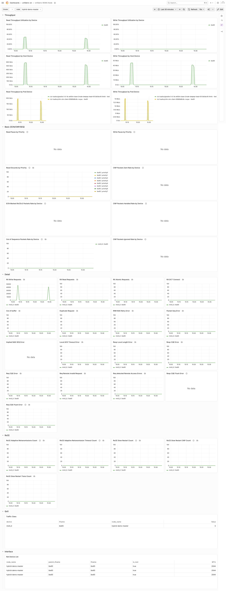

# RDMA 指标

English version: [rdma-metrics.md](./rdma-metrics.md)

## 简介

Agent 在每个节点上采集 RDMA 网卡的计数器,并以 Prometheus 指标导出。
指标覆盖主机网卡和 Pod 网卡。
每个样本带有网络类型标签,Pod 维度的样本还带有 Pod 和 workload 标签。
本文说明如何配置、验证和查看 RDMA 指标。

| 项目 | 说明 |
| --- | --- |
| 观测位置 | ③ 主机与 Pod 的 RDMA 网卡 |
| 适用网络 | Scale-out、Storage、Scale-up 中的 RDMA 网卡 |
| 数据来源 | `/sys/class/infiniband` 中的 `counters` 和 `hw_counters`,`/sys/class/net` 中的网卡属性,ethtool 优先级计数器 |
| 归因粒度 | 节点、网卡、Pod、workload |
| 输出 | `unifabric_*` 指标,RDMA 集群、节点、Pod 和 AI Workload 仪表盘 |
| 节点侧要求 | Linux 节点,`/sys/class/infiniband` 中能看到 RDMA 设备。Pod 归因需要 containerd。 |
| Helm 配置 | `nodeMetrics.enabled=true` (默认),`grafanaDashboard.enabled=true` (默认) |

指标分为以下几类:

| 类别 | 示例 | 来源 |
| --- | --- | --- |
| 吞吐 | `unifabric_port_xmit_data`、`unifabric_port_rcv_data`、`unifabric_unicast_xmit_packets` | `counters` |
| 拥塞 | `unifabric_np_ecn_marked_roce_packets`、`unifabric_np_cnp_sent`、`unifabric_rp_cnp_handled`、`unifabric_out_of_sequence` | `hw_counters` |
| 错误与重传 | `unifabric_local_ack_timeout_err`、`unifabric_packet_seq_err`、`unifabric_req_cqe_error`、`unifabric_out_of_buffer` | `hw_counters` |
| 网卡属性 | `unifabric_port_speed_mbps`、`unifabric_port_mtu`、`unifabric_port_oper_state`、`unifabric_rdma_device_tos` | `/sys/class/net`、设备 traffic class |
| 优先级 | `unifabric_rx_pause`、`unifabric_tx_pause`、`unifabric_rx_discards`、`unifabric_tx_discards` | ethtool |

`hw_counters` 中的计数器由网卡驱动提供。
不同网卡和驱动版本提供的计数器不同。
RoCE 专有的计数器 (例如 ECN 和 CNP) 只在 RoCE 网卡上出现。

所有样本使用同一套标签。主要标签如下:

| 标签 | 含义 |
| --- | --- |
| `node_name` | 节点名称。 |
| `device` | RDMA 设备,例如 `mlx5_0`。 |
| `ifname` | RDMA 设备对应的网卡。 |
| `parent_ifname` | VF 对应的 PF 网卡。对于 PF,与 `ifname` 相同。 |
| `kind` | 网卡所属的网络: `scaleOut`、`storage`、`scaleUp`,或者为空。 |
| `scope` | `host` 或 `pod`。 |
| `pod_namespace`、`pod_name` | Pod 维度样本所属的 Pod。 |
| `topowner_kind`、`topowner_namespace`、`topowner_name` | Pod 的顶层 workload。 |
| `host_rdma` | Pod 是否以 host 模式使用 RDMA。 |

全部标签参见 [RDMA 指标模型与 Pod 归因设计](../../design/rdma-metrics.zh.md#指标模型)。

限制:

- RDMA 指标记录每张网卡收发了多少流量,不记录流量发给了谁。要查看通信对端,使用 [基于 eBPF 的 RDMA tracing](./rdma-flow.zh.md)。
- 指标是抓取时刻的计数器值。Agent 不保存历史,历史数据由 Prometheus 保存。
- 只有 RDMA Pod 才有 Pod 维度的样本。识别条件参见 [RDMA Pod 的识别](#rdma-pod-的识别)。
- 对于 host 模式的 Pod,Pod 维度的样本是主机网卡样本的副本。多个 host 模式的 Pod 共用一张网卡时,它们的样本相同。

RDMA 指标覆盖流量观测范围中的 ③ 主机与 Pod 的 RDMA 网卡。完整的观测范围和其他位置的观测方式,参见[高速网络流量观测](./README.zh.md#流量观测范围)。

## 前提条件

- 满足[高速网络流量观测](./README.zh.md#前提条件)中的前提条件。
- 节点上能看到 RDMA 设备:

  ```bash
  kubectl -n unifabric-system exec ds/unifabric-agent -c agent -- ls /sys/class/infiniband
  ```

## 配置

RDMA 指标默认开启。
基础安装完成后,Agent 已开始导出指标,Chart 已创建 `ServiceMonitor` 和仪表盘。
只有以下场景需要修改配置。

### 区分网络类型

默认情况下,Agent 把所有 RDMA 网卡归类为 `scaleOut`。
如果节点上有存储网卡或 Scale-up 网卡,配置对应的 selector。
例如,把 `eth5` 和 `eth6` 归类为 `storage`:

```bash
helm upgrade --install unifabric oci://ghcr.io/unifabric-io/charts/unifabric \
  --namespace unifabric-system \
  --reuse-values \
  --set fabricNode.storageInterfaceSelector="interface=eth5\,eth6" \
  --wait
```

Agent 按以下顺序确定 `kind`:

1. 匹配 `fabricNode.storageInterfaceSelector` 的网卡为 `storage`。
2. 匹配 `fabricNode.scaleUpInterfaceSelector` 的网卡为 `scaleUp`。
3. 匹配 `fabricNode.scaleOutInterfaceSelector` 的网卡为 `scaleOut`。
4. 如果没有配置 `scaleOutInterfaceSelector`,其余网卡为 `scaleOut`。

Agent 先用 `parent_ifname` 匹配,再用 `ifname` 匹配。
selector 支持 `interface=eth*,!eth9` 和 `cidr=172.17.0.0/16` 两种形式。

> 注意: 这些 selector 同时决定拓扑发现中的网卡归类。

### 配置 Prometheus 抓取

Chart 只在 `nodeMetrics.enabled` 和 `serviceMonitor.enabled` 都为 `true` 时创建 `ServiceMonitor`。两者默认都为 `true`。

如果 Prometheus 按标签选择 `ServiceMonitor`,在 values 中添加这些标签:

```yaml
nodeMetrics:
  serviceMonitor:
    labels:
      release: prometheus
    interval: 15s
```

### 配置仪表盘

`grafanaDashboard.*` 参数控制仪表盘的安装方式:

| 参数 | 默认值 | 说明 |
| --- | --- | --- |
| `grafanaDashboard.kind` | `GrafanaDashboard` | `GrafanaDashboard` 由 Grafana Operator 导入。`ConfigMap` 由 Grafana sidecar 导入。 |
| `grafanaDashboard.language` | `en` | `en` 安装英文仪表盘。`zh` 安装中文仪表盘,uid 和资源名带 `-zh` 后缀。`all` 同时安装两种。 |
| `grafanaDashboard.instanceSelector` | `{}` | Grafana Operator 管理多个 Grafana 实例时,选择目标实例。 |
| `grafanaDashboard.labels` | `{}` | 添加到仪表盘资源上的标签。Grafana sidecar 按标签发现 `ConfigMap` 时使用。 |

例如,安装中文仪表盘:

```bash
helm upgrade --install unifabric oci://ghcr.io/unifabric-io/charts/unifabric \
  --namespace unifabric-system \
  --reuse-values \
  --set grafanaDashboard.language=zh \
  --wait
```

## Pod 与 workload 归因

Agent 先把样本归因到 Pod,再沿 Pod 的 `ownerReferences` 向上追溯,找到顶层 workload,例如 `PyTorchJob` 或 `LeaderWorkerSet`。
`pod_namespace`、`pod_name` 和 `topowner_*` 标签记录这个结果。
[基于 eBPF 的 RDMA tracing](./rdma-flow.zh.md) 的 `*_top_owner_*` 标签使用同样的解析规则。

### RDMA Pod 的识别

只有 RDMA Pod 才有 Pod 维度的样本。
Agent 把以下两类 Pod 识别为 RDMA Pod,并写入 `FabricNode.status.rdmaPods`:

- SR-IOV 模式: Pod 的 `k8s.v1.cni.cncf.io/network-status` annotation 中包含 `rdma-device`。Multus 和 SR-IOV CNI 写入这个 annotation。
- host 模式: Pod 设置了 `hostNetwork: true`,并且至少一个容器是特权容器,同时挂载了 `/dev/infiniband`。

查看一个节点上识别到的 RDMA Pod:

```bash
kubectl get fabricnode node1 -o jsonpath='{range .status.rdmaPods[*]}{.namespace}{"\t"}{.name}{"\t"}{.hostRDMA}{"\t"}{.topOwner.kind}/{.topOwner.name}{"\n"}{end}'
```

<!-- TODO: 待真实环境采集输出 -->

> 注意: 通过 DRA 分配 RDMA 设备的 Pod (例如使用 DraNet) 暂不能被识别为 RDMA Pod。参见 [#47](https://github.com/unifabric-io/unifabric/issues/47)。

> 注意: SR-IOV 模式的 Pod 归因依赖 containerd。其他容器运行时的 Pod 不产生 Pod 维度的样本。主机维度的样本不受影响。

### 顶层 workload 的解析

Agent 读取 owner 链上的每个对象,所以它需要这些资源的 `get` 权限。
Chart 默认授予以下资源的读取权限:

- Kubernetes 内置资源: `Deployment`、`ReplicaSet`、`StatefulSet`、`DaemonSet`、`Job`、`CronJob`。
- `agent.workloadOwnerRules` 中的第三方资源。默认值包括 Kubeflow Training Operator、Kubeflow Trainer、JobSet、LeaderWorkerSet、KubeRay 和 Spark Operator 的 workload。

如果你的 workload 控制器不在列表中,在 `agent.workloadOwnerRules` 中添加它的 API 组和复数资源名。
用户提供的值与默认值合并。
例如,添加 Argo Workflows:

```yaml
agent:
  workloadOwnerRules:
    argoproj.io: [workflows]
```

Chart 把这些规则渲染为 `<release>-agent-workload-owners` ClusterRole。

权限不足时,两种观测方式的行为不同:

- RDMA 指标: 如果 Agent 读不到 owner 链上的任何一个对象,`topowner_*` 标签为空。
- 基于 eBPF 的 RDMA tracing: Agent 只追溯 [owners.go](../../../pkg/agent/ebpfflow/owners.go) 中列出的资源类型。遇到列表外的类型时,Agent 把这一层作为顶层 workload。要继续向上追溯,必须在 `owners.go` 中添加这个类型。

## 验证

1. 确认 Service 和 `ServiceMonitor` 存在:

   ```bash
   kubectl -n unifabric-system get service unifabric-agent-metrics
   kubectl -n unifabric-system get servicemonitor unifabric-agent-metrics
   ```

2. 在一个终端中对 Agent Pod 执行端口转发:

   ```bash
   AGENT_POD=$(kubectl -n unifabric-system get pod \
     -l app.kubernetes.io/component=unifabric-agent \
     --field-selector=status.phase=Running \
     -o jsonpath='{.items[0].metadata.name}')
   kubectl -n unifabric-system port-forward "pod/$AGENT_POD" 8082:8082
   ```

3. 在另一个终端中确认网卡归类正确:

   ```bash
   curl -s http://127.0.0.1:8082/metrics | grep '^unifabric_port_xmit_data' | grep 'scope="host"'
   ```

   <!-- TODO: 待真实环境采集输出 -->

   每张网卡的 `kind` 应与 selector 的配置一致。

4. 如果节点上有 RDMA Pod,确认 Pod 维度的样本存在:

   ```bash
   curl -s http://127.0.0.1:8082/metrics | grep '^unifabric_port_xmit_data' | grep 'scope="pod"'
   ```

   <!-- TODO: 待真实环境采集输出 -->

5. 确认仪表盘资源存在:

   ```bash
   kubectl -n unifabric-system get grafanadashboard -l app.kubernetes.io/component=unifabric
   ```

   如果 `grafanaDashboard.kind=ConfigMap`,执行:

   ```bash
   kubectl -n unifabric-system get configmap -l app.kubernetes.io/component=unifabric
   ```

## 查看仪表盘

RDMA 指标使用以下四个仪表盘。
从集群总览开始,逐级定位到节点、Pod 或 workload。

### Unifabric RDMA 集群

集群的总览,包括以下分组:

- 概览: 具备 RDMA 的节点、workload 和 Pod 数量,集群和每个节点的读写吞吐与吞吐利用率。
- 热点: 读写吞吐最高的 10 个节点、Pod 和 workload。
- 节点状态: 每个节点 PF 的 pause、丢弃、ECN 标记、CNP 和乱序报文。
- Pod 状态: 乱序报文和丢弃最多的 10 个 Pod。


### Unifabric RDMA 节点

一个节点上每张网卡的详细数据,包括以下分组:

- 吞吐: 每个设备的吞吐利用率,主机设备和 Pod 设备的读写吞吐。
- 基础(ECN/CNP/SEQ): 各优先级的 pause 和丢弃,每个设备的 ECN 标记、CNP 和乱序报文。
- 明细: 接收的 Write、Read、Atomic 请求,以及各类错误计数器。
- RoCE: RoCE 自适应重传和慢启动。
- QoS: 每个设备的流量类别。
- 接口: 网络设备列表。



### Unifabric RDMA Pod

一个 Pod 的网卡数据,包括以下分组:

- 概览、RDMA 基础统计: Pod 网卡的收发吞吐。
- RDMA 错误统计: Pod 网卡的错误和重传。
- RDMA 发送明细(CPU 侧发起): 来自 基于 eBPF 的 RDMA tracing。参见 [基于 eBPF 的 RDMA tracing](./rdma-flow.zh.md#验证)。


### Unifabric RDMA AI Workload

按顶层 workload 汇总的数据。
用 `kind`、`namespace` 和 `name` 变量选择一个 workload,例如一个 `PyTorchJob`。
仪表盘列出这个 workload 下所有 Pod 的流量。
"RDMA 发送明细(CPU 侧发起)"分组来自 基于 eBPF 的 RDMA tracing。


## 故障排查

### 没有任何 RDMA 指标

1. 确认 Agent 正常运行:

   ```bash
   kubectl -n unifabric-system get daemonset unifabric-agent
   kubectl -n unifabric-system logs ds/unifabric-agent -c agent --tail 200
   ```

2. 确认节点上能看到 RDMA 设备:

   ```bash
   kubectl -n unifabric-system exec ds/unifabric-agent -c agent -- ls /sys/class/infiniband
   ```

   如果目录为空,检查网卡驱动和 RDMA 内核模块。

3. 确认节点的 `FabricNode` 存在:

   ```bash
   kubectl get fabricnodes
   ```

   如果 `FabricNode` 不存在,Agent 返回空的指标。

4. 如果 Agent 本地有指标,但 Prometheus 中没有数据,参见 [Prometheus 中没有指标](#prometheus-中没有指标)。

### Prometheus 中没有指标

1. 确认 Agent 本地能返回指标。参见[验证](#验证)。

2. 确认 Service 和 `ServiceMonitor` 存在:

   ```bash
   kubectl -n unifabric-system get service,servicemonitor \
     -l app.kubernetes.io/component=unifabric-agent
   ```

3. 在 Prometheus 的 Targets 页面中,确认 `unifabric-agent-metrics` 的抓取目标为 `UP`。
   如果 Prometheus 按标签选择 `ServiceMonitor`,在 `nodeMetrics.serviceMonitor.labels` 中添加这些标签。

### 没有 Pod 维度的指标

1. 确认目标 Pod 出现在 `FabricNode.status.rdmaPods` 中。参见 [RDMA Pod 的识别](#rdma-pod-的识别)。
2. 如果 Pod 不在列表中,确认它满足 SR-IOV 模式或 host 模式的条件。
3. 如果 Pod 在列表中,但仍没有 Pod 维度的样本,确认节点使用 containerd。

### workload 标签为空或停在中间资源

- `topowner_*` 标签为空: 为 owner 链上的资源添加读取权限。参见[顶层 workload 的解析](#顶层-workload-的解析)。
- `rdma_flow_*` 的 `*_top_owner_kind` 停在 Kubernetes 内置资源 (例如 `ReplicaSet`): 确认 Agent 有上一层资源的读取权限。
- `rdma_flow_*` 的 `*_top_owner_kind` 是一个第三方资源,但它不是最顶层: 这个类型不在 `owners.go` 中。

### kind 标签为空或不正确

- 检查 `fabricNode.scaleOutInterfaceSelector`、`fabricNode.storageInterfaceSelector` 和 `fabricNode.scaleUpInterfaceSelector`。
- 如果配置了 `scaleOutInterfaceSelector`,不匹配任何 selector 的网卡的 `kind` 为空。
- selector 先匹配 `parent_ifname`。对于 VF,用 PF 的名称配置 selector。

### 仪表盘没有数据

1. 在 Grafana Explore 中查询 `unifabric_node_info`,确认 Prometheus 数据源中有 Unifabric 指标。
2. 确认仪表盘的 `cluster`、`node`、`namespace` 等变量选中了实际产生 RDMA 流量的对象。
3. 确认仪表盘的时间范围内有 RDMA 流量。

## 参考

- [高速网络流量观测](./README.zh.md): 流量观测范围,以及 Pod 身份的关联规则。
- [基于 eBPF 的 RDMA tracing](./rdma-flow.zh.md): 查看 RDMA 流量的通信对端。
- [RDMA 指标模型与 Pod 归因设计](../../design/rdma-metrics.zh.md): 数据来源、采集流程和指标模型。
- [FabricNode 参考](../../reference/fabricnode.zh.md): `status.rdmaPods` 字段。
- [Helm values 参考](../../../chart/README.md): 全部 `nodeMetrics.*`、`fabricNode.*` 和 `grafanaDashboard.*` 参数。
